# UML

Diagrams for LifeEngine: class structure, runtime interactions, object
lifecycles, activities and use cases. All diagrams are Mermaid, so they render
directly on GitHub and in any Mermaid-aware Markdown viewer.

---

## Contents

- [1. Class diagram: simulation](#1-class-diagram-simulation)
- [2. Class diagram: biology](#2-class-diagram-biology)
- [3. Class diagram: animal kingdom](#3-class-diagram-animal-kingdom)
- [4. Class diagram: molecular biology](#4-class-diagram-molecular-biology)
- [5. Class diagram: ecology](#5-class-diagram-ecology)
- [6. Sequence: one generation](#6-sequence-one-generation)
- [7. Sequence: clicking a cell](#7-sequence-clicking-a-cell)
- [8. Sequence: building the default world](#8-sequence-building-the-default-world)
- [9. State: simulation lifecycle](#9-state-simulation-lifecycle)
- [10. State: a cell](#10-state-a-cell)
- [11. Activity: start-up](#11-activity-start-up)
- [12. Activity: sizing the grid](#12-activity-sizing-the-grid)
- [13. Use cases](#13-use-cases)

---

## 1. Class diagram: simulation

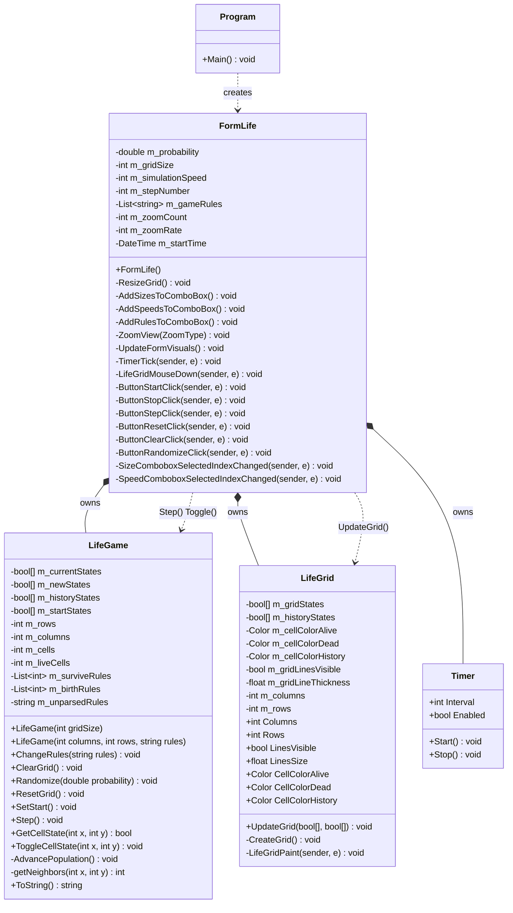

`FormLife` is the only class that knows about both other parties. `LifeGame` and
`LifeGrid` never reference each other, which is why the arrays have to be copied
across by the form.

---

## 2. Class diagram: biology

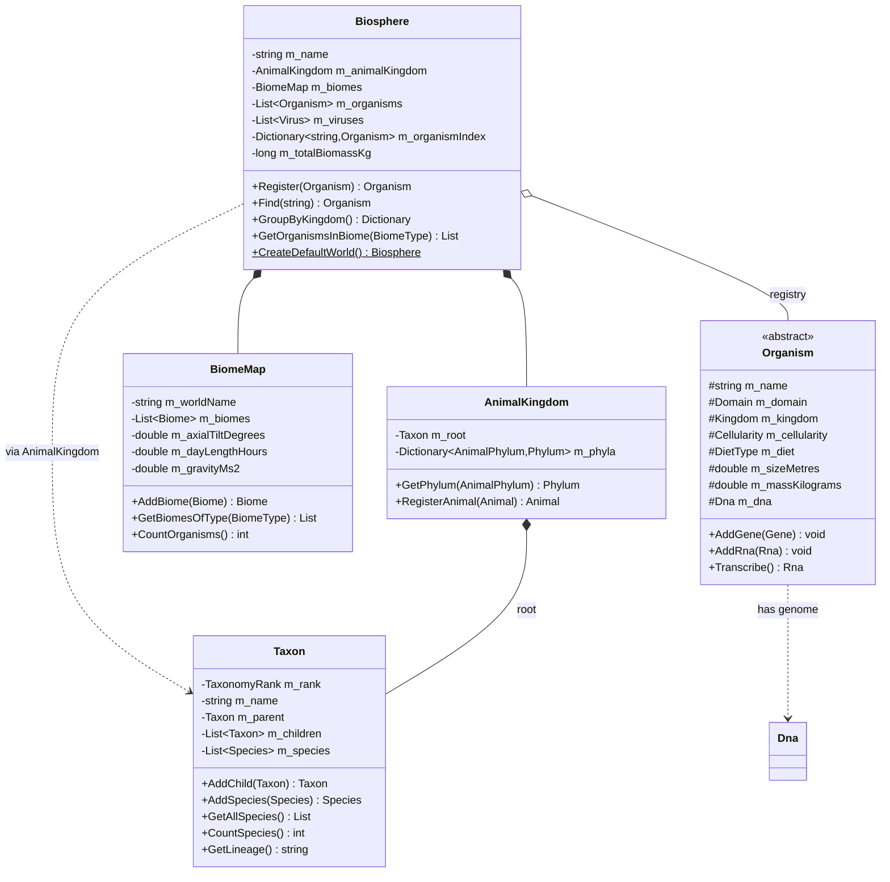

---

## 3. Class diagram: animal kingdom

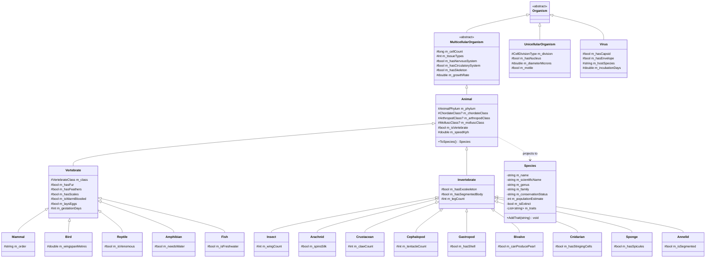

`AnimalKingdom` files each concrete animal under its phylum by calling
`ToSpecies()`, so one registration populates both the object graph and the
taxonomy tree.

---

## 4. Class diagram: molecular biology

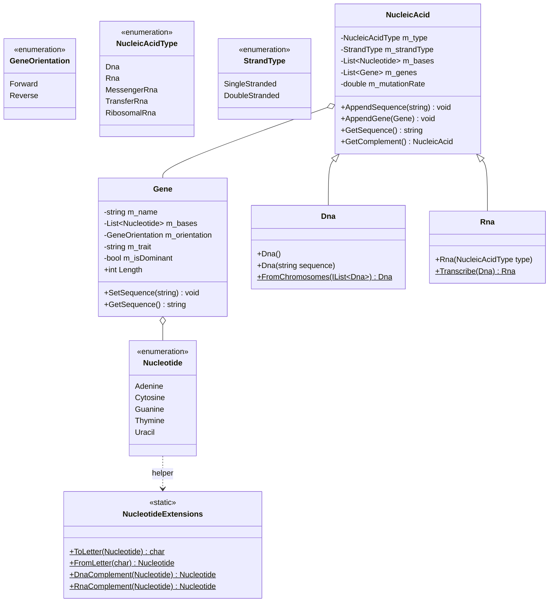

Complementarity: DNA pairs A-T and C-G; RNA pairs A-U and C-G. `Rna.Transcribe`
copies a `Dna` strand substituting thymine with uracil, which is the operation
`Organism.Transcribe()` exposes.

---

## 5. Class diagram: ecology

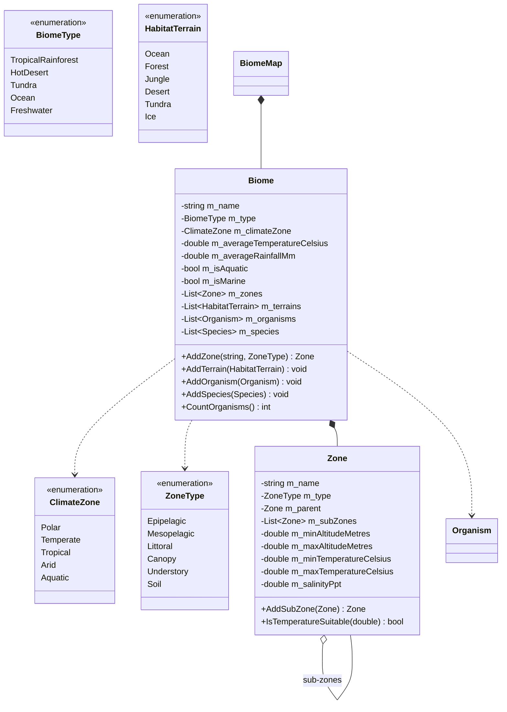

Zones nest, which is how an ocean gets an epipelagic band that itself contains
sub-zones, and how a forest gets a canopy above an understory above a floor.

---

## 6. Sequence: one generation

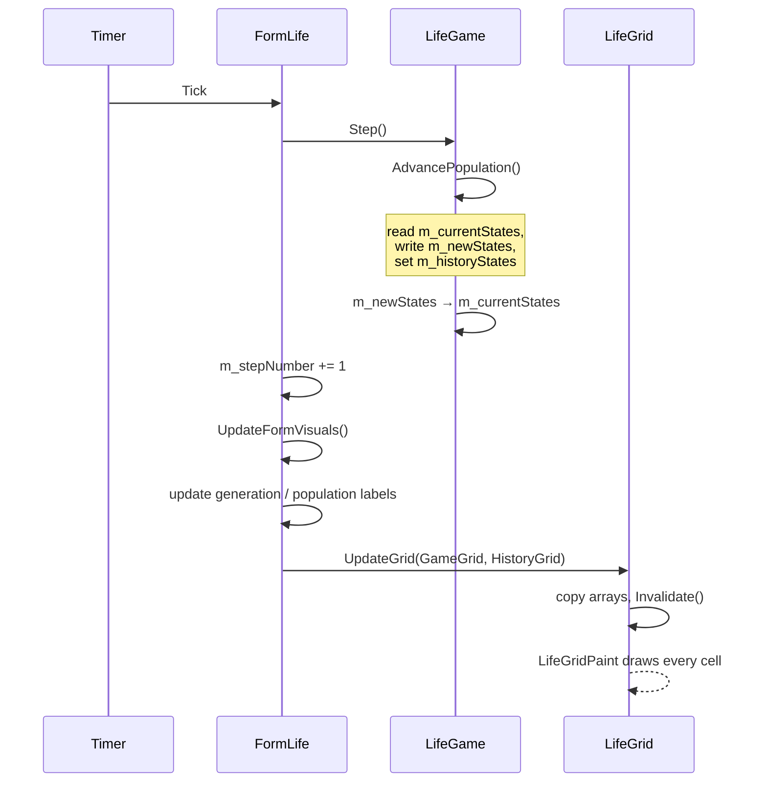

The important property is that `Step()` completes before any painting is
requested. The grid control is never asked to render a half-computed board.

---

## 7. Sequence: clicking a cell

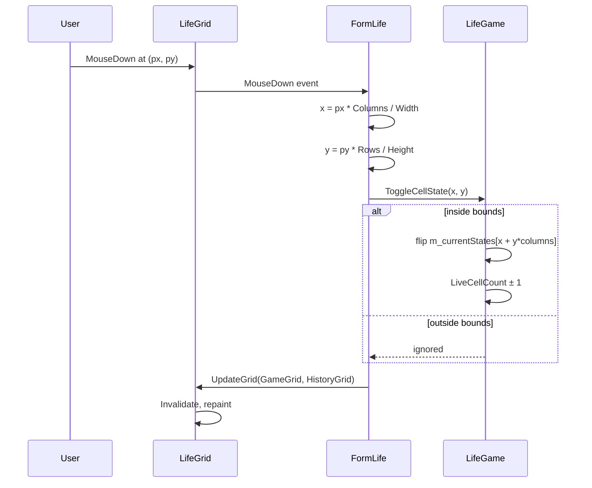

`ToggleCellState` bounds-checks because the pixel-to-cell division can round to
`Columns` or `Rows` on the last pixel of the control.

---

## 8. Sequence: building the default world

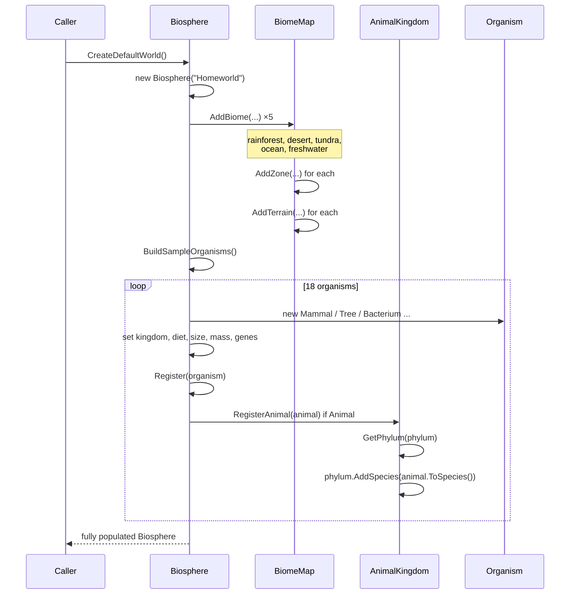

---

## 9. State: simulation lifecycle

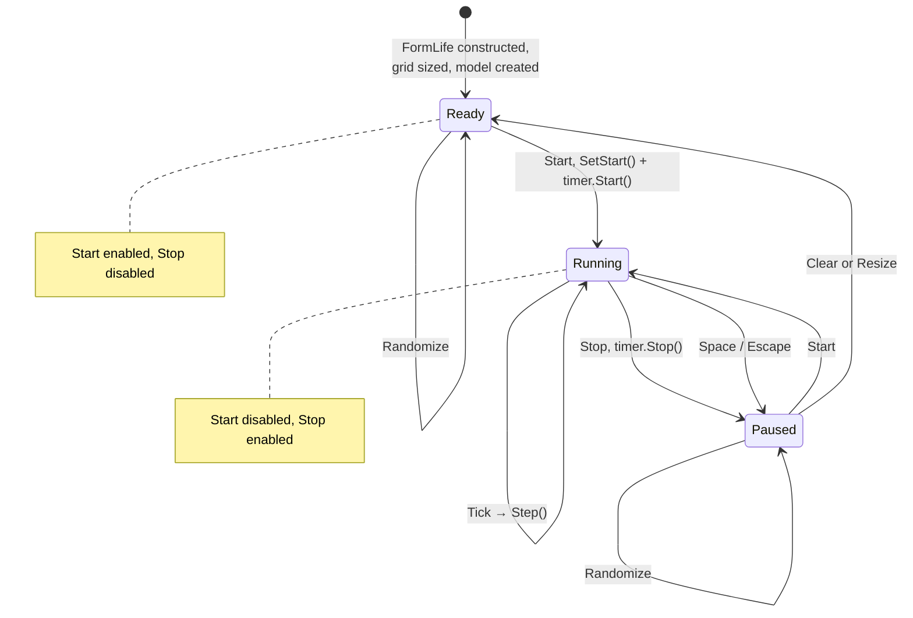

`Ready` is the state after construction, after Clear and after a resize. `Paused`
is reached only by stopping a run, which is why Reset and Randomize are
available from `Paused` but not listed from `Ready`.

---

## 10. State: a cell

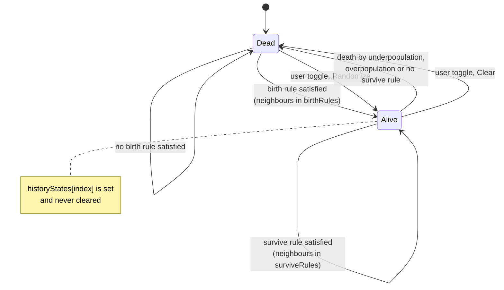

The history flag is a one-way latch. A cell that has ever been alive keeps
`historyStates[index] == true` until `ClearGrid()` runs, which is what produces
the fading trail behind a moving pattern.

---

## 11. Activity: start-up

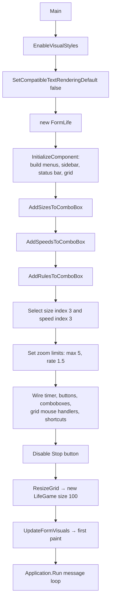

---

## 12. Activity: sizing the grid

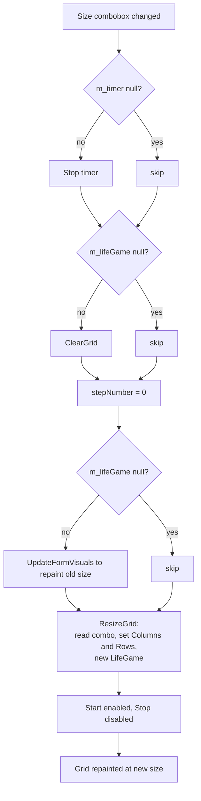

Both null checks matter: the combobox fires `SelectedIndexChanged` during
construction, before the timer and the model exist.

---

## 13. Use cases

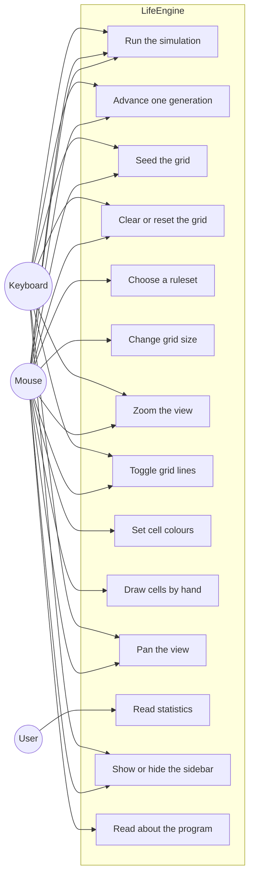

Every case reachable from the keyboard is also reachable from the mouse, with
the single exception of free scrolling by arrow key.

---

## Source of the model

The biological half of the design takes its cue from
[SproutLife](https://github.com/ShprAlex/SproutLife) by Alex Shapiro (MIT): cells
owned by an organism, organisms carrying a genome, mutations accumulating with
age. LifeEngine's `Organism`, `Genome`-equivalents (`Dna`, `Gene`) and
`Biosphere` registry are original C# taken in that direction — no SproutLife
code is copied, and SproutLife itself is Java and has no Windows Forms UI.
